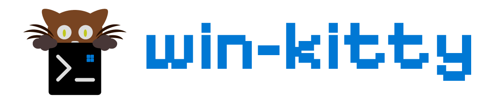

<p align="center">
  
</p>

<p align="center">
  <br>
  <a href="https://github.com/ecstra/win-kitty/actions/workflows/ci.yml"></a>
  <a href="LICENSE"></a>
  <a href="https://github.com/ecstra/win-kitty/releases"></a>
  <a href="https://sw.kovidgoyal.net/kitty/"></a>
  <br><br>
</p>

## Overview

[kitty](https://github.com/kovidgoyal/kitty) is a fast terminal that draws everything on your graphics card. This is kitty running natively on Windows 11. No WSL, no X server, nothing to set up first.

I built it so I could use kitty as my daily terminal on Windows, and it does that for me. It is still young and it has bugs. The things under What works are the ones I use every day, so they get the most testing.

> [!NOTE]
> I work on this in my free time, so progress might be slow. There is no roadmap and no promised dates.

> [!IMPORTANT]
> None of the Windows work is in upstream kitty. Report problems with this build [here](https://github.com/ecstra/win-kitty/issues), not on the upstream tracker.


## What works

* **Acrylic:** the same frosted glass background Windows Terminal has, and it stays frosted when the window loses focus.
* **Title bar:** kitty draws its own in the terminal's colours, so the whole window looks like one piece.
* **Shells:** pwsh, Windows PowerShell, cmd, and MSYS2 or Cygwin shells like zsh and bash, with shell integration for each.
* **No flicker in zsh:** MSYS2 and Cygwin shells get a real terminal of their own, so zsh stays still while you type.
* **Images:** `kitten icat` and the kitty graphics protocol.
* **Kittens:** icat, hints, unicode_input, diff, themes, choose-files and ask.
* **Remote control:** `kitty @` over `listen_on tcp:`.
* **Notifications:** real Windows notifications from kitty.
* **Explorer:** an Open in kitty entry when you right click a folder.
* **Low input lag:** typing feels instant, and kitty draws at your monitor's real refresh rate.
* **The rest of kitty:** tabs, OS windows, scrollback, mouse selection, the clipboard, ligatures, per monitor scaling, live config reload, and dropping files onto a window.

## What is missing

* Dragging tabs to move them around or into another window.
* Remote control over `listen_on unix:`. TCP works.
* The dnd, panel, quick-access-terminal and desktop-ui kittens.
* Dragging text or files out of a window. Dropping them in works.
* `kitty +something` commands and the full `kitty --help` when you run them from another terminal.
* Kittens outside kitty. Run them from a kitty window.
* Custom shaders, since the installer does not include the Slang compiler they need yet.
* A few things new in kitty 0.49 to 0.51: the launch wrapper, saving your session when you log out, and the memory use of a tab's programs in tab titles.
* Emoji typed at an MSYS2 zsh prompt show up in pieces like `<d83d>`. That is zsh on Cygwin and it happens in Windows Terminal too. Emoji in output are fine.

The full list, with what is still untested, is in [docs/windows-port.md](docs/windows-port.md).

## Install

1. Download `kitty-setup.exe` from the [latest release](https://github.com/ecstra/win-kitty/releases/latest).
2. Run it and say yes to the administrator prompt.
3. Pick whether you want kitty on your PATH, the Explorer entry and a desktop shortcut.

Everything kitty needs comes with it. For a silent install, run

```
kitty-setup.exe /VERYSILENT /SUPPRESSMSGBOXES /NORESTART
```

## Configuration

kitty reads `%USERPROFILE%\.config\kitty\kitty.conf`, the same place it uses on Linux. It does not look in `%APPDATA%`.

1. Make the folder `%USERPROFILE%\.config\kitty`, since the installer does not.
2. For the setup in the screenshot, copy `kitty.conf` and the `kitty-themes` folder from [example/.config/kitty](example/.config/kitty) into it.

Save the file and kitty picks up the change without a restart. To keep your config somewhere else, set `KITTY_CONFIG_DIRECTORY`.

## Problems

Open an [issue](https://github.com/ecstra/win-kitty/issues) and say what you did, what you saw, your Windows version and which shell you were in. [CONTRIBUTING.md](CONTRIBUTING.md) has the rest. If it also happens on Linux or macOS, it belongs on the [upstream tracker](https://github.com/kovidgoyal/kitty/issues).

## Build

1. Install [MSYS2](https://www.msys2.org/) and open its UCRT64 shell with `C:\msys64\msys2_shell.cmd -ucrt64`.
2. Install the toolchain.

   ```bash
   pacman -S --needed \
       base-devel \
       mingw-w64-ucrt-x86_64-gcc \
       mingw-w64-ucrt-x86_64-pkgconf \
       mingw-w64-ucrt-x86_64-python \
       mingw-w64-ucrt-x86_64-go \
       mingw-w64-ucrt-x86_64-harfbuzz \
       mingw-w64-ucrt-x86_64-freetype \
       mingw-w64-ucrt-x86_64-fontconfig \
       mingw-w64-ucrt-x86_64-cairo \
       mingw-w64-ucrt-x86_64-libpng \
       mingw-w64-ucrt-x86_64-xxhash \
       mingw-w64-ucrt-x86_64-openssl \
       mingw-w64-ucrt-x86_64-ncurses \
       mingw-w64-ucrt-x86_64-lcms2 \
       mingw-w64-ucrt-x86_64-ruff \
       mingw-w64-ucrt-x86_64-glslang
   ```

3. Install [Inno Setup](https://jrsoftware.org/isinfo.php) and the Windows SDK, which the installer step needs.

   ```powershell
   winget install JRSoftware.InnoSetup
   ```

4. Put Symbols Nerd Font Mono in `fonts/`, unless you have it installed already.

   ```bash
   mkdir -p /tmp/nerd fonts
   curl -fsSL -o /tmp/nerd.tar.xz https://github.com/ryanoasis/nerd-fonts/releases/latest/download/NerdFontsSymbolsOnly.tar.xz
   tar -xf /tmp/nerd.tar.xz -C /tmp/nerd
   cp /tmp/nerd/SymbolsNerdFontMono-Regular.ttf fonts/
   ```

5. Get the Slang shader compiler at the version in `bypy/sources.json`, and point `SLANGC` at it. An older one, such as the Vulkan SDK's, writes shaders the build rejects.

   ```bash
   mkdir -p /tmp/slang
   curl -fsSL -o /tmp/slang.tar.gz https://github.com/shader-slang/slang/releases/download/v2026.14.1/slang-2026.14.1-windows-x86_64.tar.gz
   tar -xzf /tmp/slang.tar.gz -C /tmp/slang
   export SLANGC="$(cygpath -m /tmp/slang/bin/slangc.exe)"
   ```

6. Build the installer. It lands in `dist/kitty-setup.exe`.

   ```bash
   ./packaging/windows/make-installer.sh
   ```

Outside a UCRT64 shell, run `export GOROOT=/ucrt64/lib/go` first, or Go cannot find its own standard library.

## Documentation

* [example/.config/kitty](example/.config/kitty): a working config with notes on what behaves differently on Windows.
* [docs/windows-port.md](docs/windows-port.md): installing, building, the Windows defaults, and what is not there yet.
* [docs/windows-changelog.md](docs/windows-changelog.md): what changed in each release.
* [docs/windows-internals.md](docs/windows-internals.md): how each Windows piece works.
* [docs/decisions.md](docs/decisions.md): why things were done the way they were.

## Credits

kitty is made by [Kovid Goyal](https://github.com/kovidgoyal), and everything that makes it good is his work. This fork adds the Windows port, by **ecstra**. The [upstream documentation](https://sw.kovidgoyal.net/kitty/) applies here too.

Licensed under GPLv3, the same as upstream.
